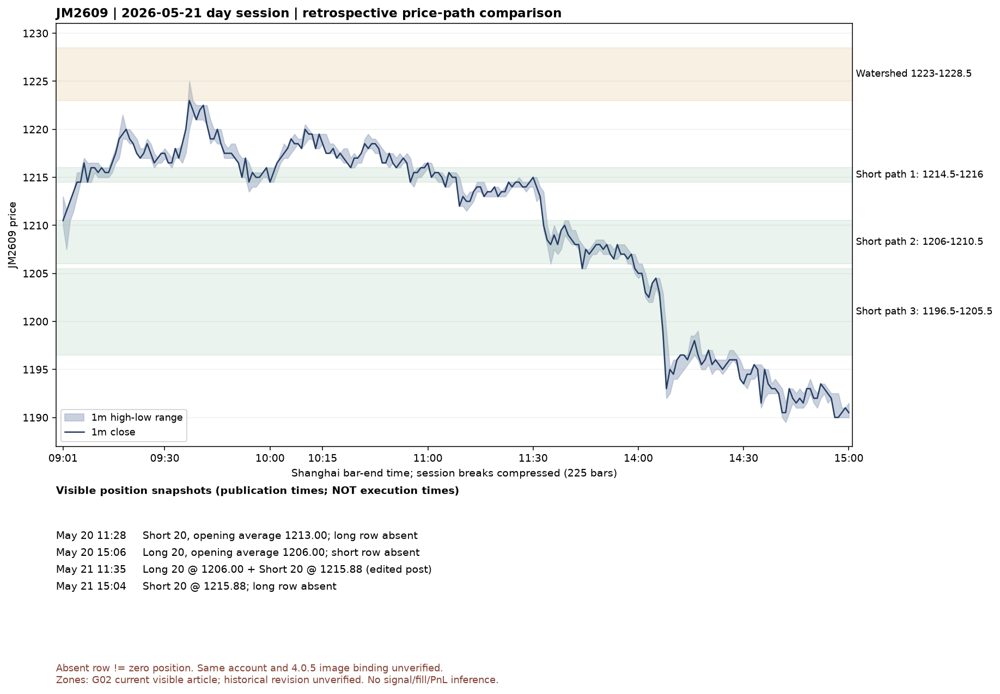

# JM2609：前日计划、四张持仓快照与逐分钟价格核验

更新：2026-10-17。结论：**价格路径得到部分核对，持仓变化与作者叙述相容，原版触发及完整动作链仍未识别。** 本案例不是可执行回测，不计算收益。来源摘要见[增量索引G01–G09](jm2609-may-20261016.csv)，机器输出见[几何核验](jm2609-may-geometry.json)。

## 1. 找到的原始链条

[5月20日17:24发布入口](https://weibo.com/1885745060/R0ieMw9ID)链接至[当日V+文章](https://weibo.com/ttarticle/p/show?id=2309405300701084647924)。JM2609章节明确写4.0.5，说明尾盘M触发抓M处理，趋势交易暂挂并转短线；之后等待强弱分化，才能决定顺原空向或试新方向。分水岭1223–1228.5，两侧按各自VPLUS信号选择左/右侧参与。

- 多向路径：1229–1235，然后有条件地看1241.5–1248.5。
- 空向路径：1214.5–1216，然后1206–1210.5，两者完成再看1196.5–1205.5。
- 保护依据随入场位置变化，结合路径节点和附近反向VPLUS；未披露机械确认公式。

当前文章在已登录Chrome内正常可读，没有购买或绕过限制。未见编辑标记不等于从未编辑，当前内容不能直接认定为2026-05-20当时可知的不可变版本。

[5月21日16:44复盘F08](https://weibo.com/1885745060/R0roUmhY8)明确4.0.5，叙述锁定多单后恢复空向、日盘最高1225最低1189.5。其正文“给多方”与附图及前文的试错空单段落不一致；可能是笔误，尚未确定。记录矛盾，区域方向以原文章章节分别保存，不将原文静默修正。两张附图都是文字区域，**不是K线信号图**。

## 2. 四张快照能证明到哪里

时间是微博显示发布时间，不是截图时刻。未列出的方向记为未知，不填0。下列数量及均价均为截图显示值，不是核验后的Broker事实。

|发布时刻（上海）|来源及图片|可见JM2609行|未证明的部分|
|---|---|---|---|
|5月20日11:28|[G06](https://weibo.com/1885745060/R0fUiiuYI)图2|空20；开仓/持仓均价1213.00；今仓20；未列多|正文未标单图版本；提前发布；无信号与成交时刻|
|5月20日15:06|[G05](https://weibo.com/1885745060/R0hkN1vCm)图2|多20；开仓/持仓均价1206.00；今仓20；未列空|正文称4.0.5敞口打开，但图片账户身份未标明|
|5月21日11:35，已编辑|[G03](https://weibo.com/1885745060/R0pnBycD8)图2|多20开均1206.00/持均1211.00/今仓0；空20开均及持均1215.88/今仓20|正文称4.0.5普遍锁定；编辑历史未展开；未确认图和正文一一绑定|
|5月21日15:04|[G04](https://weibo.com/1885745060/R0qKypi3R)图5|空20；开仓/持仓均价1215.88；今仓20；未列多|无账户标识、完整中间订单或精确截图时间|

**合理推断：**表格布局、数量、多腿开均1206及次日空腿开均1215.88的延续，与“原空向→抓反向M→保护多向→恢复空向”的叙述相容。不能排除不同账户、过滤、未展示的多次平开、编辑换图等替代解释。1213与1215.88并不相同，不能称最早空腿一直保留。开仓均价可能由多笔成交组成；持仓均价还可能受结算口径影响，两者不可互换，不据均价反推分钟级下单时间。

即使假设四图来自同一账户且完整展示持仓，快照间仍有不止一种操作顺序。例如由空转多既可先锁再平空，也可先平空再开多；两张端点图无法区分。因而没有把任何一条中间路径标记成已识别的真实动作。

## 3. 深色成交表不能补齐4.0.5的时刻

G04图4确实显示实时回报表：焦煤2609有买平和卖开且状态为全部成交；部分时间被遮挡，价量不在图内。**该表与图5账户、策略的关联均未知。** 同帖图3另有焦煤空均1194.00，与图5的1215.88不同，进一步说明不能把同帖所有图片合并成同一策略账户。

G05图4也为实时回报表，但可见行未含焦煤。它不能证明焦煤当日没有交易。表内账号已被作者遮挡，不尝试还原。

## 4. 本地行情逐分钟核验

通过既有MarketDataService读取具体JM2609、2026-05-20至05-22的1m，共1035根（含夜盘）；没有下载、替代合约、插值或写入生产数据。实际Bar结束时间覆盖北京时间5月19日21:01至5月22日15:00。原始读取记录及文件在：

- `output/lms405-jm2609-may-20261016/market-read-authorized/coverage.json`
- `output/lms405-jm2609-may-20261016/market-read-authorized/JM2609_2026-05-20_2026-05-22_1m.csv`
- CSV SHA256：`cedca0a8ce6ff61ac52f985749391abe79ff70661e43dd88adc955285b894874`

初次受沙箱连接限制的读取记录保留在`market-read/coverage.json`，状态为LOCAL_READ_UNVERIFIED；随后只读本地Catalog读取成功。这里的成功仅指统一入口可读；没有另行下载或建立第二套行情质量权威。

日盘按上海日历日09:00 < Bar结束时间 ≤ 15:00筛选，夜盘不混入下表。

|日期|日盘Bar数|本地最高|本地最低|可比较的作者披露|
|---|---:|---:|---:|---|
|5月20日|225|1222|1196.5|等于G02区域下端1196.5；不计独立极值验收|
|5月21日|225|1225|1189.5|F08最高1225、最低1189.5，价差均0|
|5月22日|225|1177|1160.5|仅覆盖记录，无本批作者极值标签|

5月21日各区域端点首次落入某根1m的high/low范围如下。这是**整段日盘的首次端点包含**，不是作者的有效测试、成交或依次经过全部节点的证明：

|区域|下端首次包含|上端首次包含|
|---|---|---|
|1223–1228.5|09:37|未包含|
|1229–1235|未包含|未包含|
|1241.5–1248.5|未包含|未包含|
|1214.5–1216|09:05|09:07|
|1206–1210.5|13:35|09:01|
|1196.5–1205.5|14:08|13:44|

1225低于分水岭上端1228.5，与作者未完成多向循环的描述相容；不能据此反推“只要没到上端就立即卖空”。特别是1206–1210.5两端相隔多个小时，不能不加条件地累计成一次完整有效测试。Bar内价格先后、作者要求的连续性、失效与重置规则仍未知。

本次1m仅为价格观察粒度。G03正文的5分钟属于1.0股指，不可当作JM2609/4.0.5周期。没有作者独立OHLC标签，不能宣布K线数据完全一致，更不能宣布信号一致。



图中区域为当前可见文章的回看叠加；快照单列，不放置虚构成交箭头。绘图脚本保存在本地`output/lms405-jm2609-may-20261016/plot_case.py`，使用冻结CSV；浮点仅用于显示，研究计算使用Decimal。

## 5. 可重放命令与验收

从仓库根运行（输出使用新文件名，拒绝覆盖；行情输入必须匹配冻结哈希）：

```bash
PYTHONDONTWRITEBYTECODE=1 PYTHONPATH=scripts/research:packages/quant-core \
services/quant-api/.venv/bin/python scripts/research/lms405_jm_may_case.py \
  --input output/lms405-jm2609-may-20261016/market-read-authorized/JM2609_2026-05-20_2026-05-22_1m.csv \
  --output /tmp/lms405-jm-may-replay.json
```

脚本复用已有`geometry`的strict-before与`daytime_extrema`，发布日期仅作明确标注的未核实代理。它不进入原版因果验收；源材料均属于开发证据，不能改称留出或盲测。后验已知的行情极值没有用来选择入场或调整参数。

- 数值层：5月21日2个披露极值价格相同；6组区域的端点观察可复算。
- 行为层：持仓快照与叙述相容；同账户、图表归属和中间顺序未确认。
- 信号层：没有周期明确且可标定时间的作者信号Bar，本批合格样本0；不计算成功率。
- 成交与收益层：无4.0.5完整订单/成交链，均为未知；不计算收益。

## 6. 取证覆盖与继续入口

本批G01–G09为9条记录，其中G07是F08复读，不增加唯一来源；其余8条详情新增（含2条版本未知的旁证）。主要按`2026.5.20`、`2026.5.21`定位，沿F08引用前日文章；后补`JM2609 BBB`（页面暂无内容）、`焦煤 tbar`（已有E55）、`焦煤 ibar`（新G08/G09）。搜索无结果不能证明材料不存在。跳过表情图、无新规则的收益宣传和其他品种持仓；未逐张读取无关图片。

[G08](https://weibo.com/1885745060/PdF1C8Rpp)是跌破1141后即使收回仍失去原持有前提的反例；[G09](https://weibo.com/1885745060/PhVeUwIMg)提及1094为原区域细分点及ibar。两篇版本未明确，附图仅为文字。它们限制过度简化的解释，但不成为4.0.5机械公式。

下一条具体入口是G09提及的2025-03-10 V+图解，先核实版本再看是否有可辨认的JM2505周期和时间轴。准备沿引用搜索时Mac进入锁屏，工具明确要求人工解锁；未绕过。当前尚未达到连续两批无新增信息的检索停止条件，不能称已穷尽作者资料。
