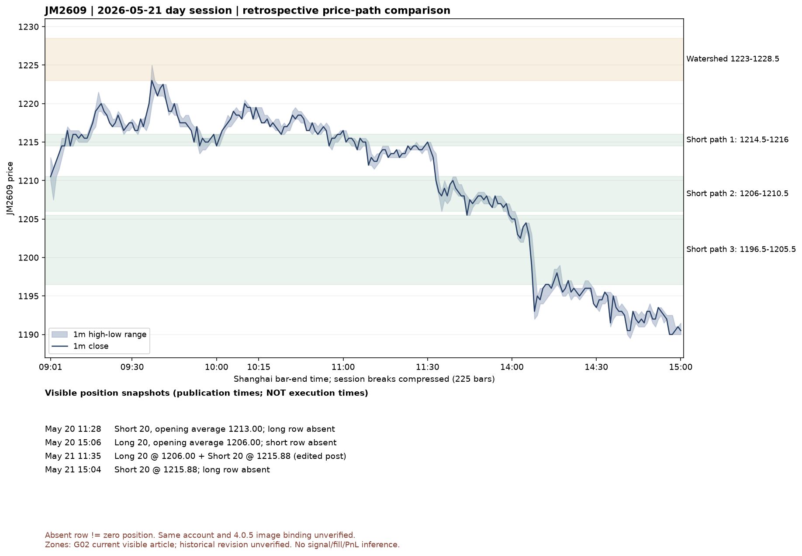

# JM2609：前日计划、四张持仓快照与逐分钟价格核验

更新：2026-10-17。结论：**价格路径得到部分核对，持仓变化与作者叙述相容，原版触发及完整动作链仍未识别。** 本案例不是可执行回测，不计算收益。来源摘要见[增量索引G01–G09](jm2609-may-20261016.csv)，机器输出见[几何核验](jm2609-may-geometry.json)。

## 1. 找到的原始链条

[5月20日17:24发布入口](https://weibo.com/1885745060/R0ieMw9ID)链接至[当日V+文章](https://weibo.com/ttarticle/p/show?id=2309405300701084647924)。JM2609章节明确写4.0.5，说明尾盘M触发抓M处理，趋势交易暂挂并转短线；之后等待强弱分化，才能决定顺原空向或试新方向。分水岭1223–1228.5，两侧按各自VPLUS信号选择左/右侧参与。

- 多向路径：1229–1235，然后有条件地看1241.5–1248.5。
- 空向路径：1214.5–1216，然后1206–1210.5，两者完成再看1196.5–1205.5。
- 保护依据随入场位置变化，结合路径节点和附近反向VPLUS；未披露机械确认公式。

当前文章在已登录Chrome内正常可读，没有购买或绕过限制。未见编辑标记不等于从未编辑，当前内容不能直接认定为2026-05-20当时可知的不可变版本。

[5月21日16:44复盘F08](https://weibo.com/1885745060/R0roUmhY8)明确4.0.5，叙述锁定多单后恢复空向、日盘最高1225最低1189.5。其正文“给多方”与附图及前文的试错空单段落不一致；可能是笔误，尚未确定。记录矛盾，区域方向以原文章章节分别保存，不将原文静默修正。两张附图都是文字区域，**不是K线信号图**。

## 2. 四张快照能证明到哪里

时间是微博显示发布时间，不是截图时刻。未列出的方向记为未知，不填0。下列数量及均价均为截图显示值，不是核验后的Broker事实。

|发布时刻（上海）|来源及图片|可见JM2609行|未证明的部分|
|---|---|---|---|
|5月20日11:28|[G06](https://weibo.com/1885745060/R0fUiiuYI)图2|空20；开仓/持仓均价1213.00；今仓20；未列多|正文未标单图版本；提前发布；无信号与成交时刻|
|5月20日15:06|[G05](https://weibo.com/1885745060/R0hkN1vCm)图2|多20；开仓/持仓均价1206.00；今仓20；未列空|正文称4.0.5敞口打开，但图片账户身份未标明|
|5月21日11:35，已编辑|[G03](https://weibo.com/1885745060/R0pnBycD8)图2|多20开均1206.00/持均1211.00/今仓0；空20开均及持均1215.88/今仓20|正文称4.0.5普遍锁定；编辑历史未展开；未确认图和正文一一绑定|
|5月21日15:04|[G04](https://weibo.com/1885745060/R0qKypi3R)图5|空20；开仓/持仓均价1215.88；今仓20；未列多|无账户标识、完整中间订单或精确截图时间|

**合理推断：**表格布局、数量、多腿开均1206及次日空腿开均1215.88的延续，与“原空向→抓反向M→保护多向→恢复空向”的叙述相容。不能排除不同账户、过滤、未展示的多次平开、编辑换图等替代解释。1213与1215.88并不相同，不能称最早空腿一直保留。开仓均价可能由多笔成交组成；持仓均价还可能受结算口径影响，两者不可互换，不据均价反推分钟级下单时间。

即使假设四图来自同一账户且完整展示持仓，快照间仍有不止一种操作顺序。例如由空转多既可先锁再平空，也可先平空再开多；两张端点图无法区分。因而没有把任何一条中间路径标记成已识别的真实动作。

## 3. 深色成交表不能补齐4.0.5的时刻

G04图4确实显示实时回报表：焦煤2609有买平和卖开且状态为全部成交；部分时间被遮挡，价量不在图内。**该表与图5账户、策略的关联均未知。** 同帖图3另有焦煤空均1194.00，与图5的1215.88不同，进一步说明不能把同帖所有图片合并成同一策略账户。

G05图4也为实时回报表，但可见行未含焦煤。它不能证明焦煤当日没有交易。表内账号已被作者遮挡，不尝试还原。

## 4. 本地行情逐分钟核验

通过既有MarketDataService读取具体JM2609、2026-05-20至05-22的1m，共1035根（含夜盘）；没有下载、替代合约、插值或写入生产数据。实际Bar结束时间覆盖北京时间5月19日21:01至5月22日15:00。原始读取记录及文件在：

- `output/lms405-jm2609-may-20261016/market-read-authorized/coverage.json`
- `output/lms405-jm2609-may-20261016/market-read-authorized/JM2609_2026-05-20_2026-05-22_1m.csv`
- CSV SHA256：`cedca0a8ce6ff61ac52f985749391abe79ff70661e43dd88adc955285b894874`

初次受沙箱连接限制的读取记录保留在`market-read/coverage.json`，状态为LOCAL_READ_UNVERIFIED；随后只读本地Catalog读取成功。这里的成功仅指统一入口可读；没有另行下载或建立第二套行情质量权威。

日盘按上海日历日09:00 < Bar结束时间 ≤ 15:00筛选，夜盘不混入下表。

|日期|日盘Bar数|本地最高|本地最低|可比较的作者披露|
|---|---:|---:|---:|---|
|5月20日|225|1222|1196.5|等于G02区域下端1196.5；不计独立极值验收|
|5月21日|225|1225|1189.5|F08最高1225、最低1189.5，价差均0|
|5月22日|225|1177|1160.5|仅覆盖记录，无本批作者极值标签|

5月21日各区域端点首次落入某根1m的high/low范围如下。这是**整段日盘的首次端点包含**，不是作者的有效测试、成交或依次经过全部节点的证明：

|区域|下端首次包含|上端首次包含|
|---|---|---|
|1223–1228.5|09:37|未包含|
|1229–1235|未包含|未包含|
|1241.5–1248.5|未包含|未包含|
|1214.5–1216|09:05|09:07|
|1206–1210.5|13:35|09:01|
|1196.5–1205.5|14:08|13:44|

1225低于分水岭上端1228.5，与作者未完成多向循环的描述相容；不能据此反推“只要没到上端就立即卖空”。特别是1206–1210.5两端相隔多个小时，不能不加条件地累计成一次完整有效测试。Bar内价格先后、作者要求的连续性、失效与重置规则仍未知。

本次1m仅为价格观察粒度。G03正文的5分钟属于1.0股指，不可当作JM2609/4.0.5周期。没有作者独立OHLC标签，不能宣布K线数据完全一致，更不能宣布信号一致。



图中区域为当前可见文章的回看叠加；快照单列，不放置虚构成交箭头。绘图脚本保存在本地`output/lms405-jm2609-may-20261016/plot_case.py`，使用冻结CSV；浮点仅用于显示，研究计算使用Decimal。

## 5. 可重放命令与验收

从仓库根运行（输出使用新文件名，拒绝覆盖；行情输入必须匹配冻结哈希）：

```bash
PYTHONDONTWRITEBYTECODE=1 PYTHONPATH=scripts/research:packages/quant-core \
services/quant-api/.venv/bin/python scripts/research/lms405_jm_may_case.py \
  --input output/lms405-jm2609-may-20261016/market-read-authorized/JM2609_2026-05-20_2026-05-22_1m.csv \
  --output /tmp/lms405-jm-may-replay.json
```

脚本复用已有`geometry`的strict-before与`daytime_extrema`，发布日期仅作明确标注的未核实代理。它不进入原版因果验收；源材料均属于开发证据，不能改称留出或盲测。后验已知的行情极值没有用来选择入场或调整参数。

- 数值层：5月21日2个披露极值价格相同；6组区域的端点观察可复算。
- 行为层：持仓快照与叙述相容；同账户、图表归属和中间顺序未确认。
- 信号层：没有周期明确且可标定时间的作者信号Bar，本批合格样本0；不计算成功率。
- 成交与收益层：无4.0.5完整订单/成交链，均为未知；不计算收益。

## 6. 取证覆盖与继续入口

本批G01–G09为9条记录，其中G07是F08复读，不增加唯一来源；其余8条详情新增（含2条版本未知的旁证）。主要按`2026.5.20`、`2026.5.21`定位，沿F08引用前日文章；后补`JM2609 BBB`（页面暂无内容）、`焦煤 tbar`（已有E55）、`焦煤 ibar`（新G08/G09）。搜索无结果不能证明材料不存在。跳过表情图、无新规则的收益宣传和其他品种持仓；未逐张读取无关图片。

[G08](https://weibo.com/1885745060/PdF1C8Rpp)是跌破1141后即使收回仍失去原持有前提的反例；[G09](https://weibo.com/1885745060/PhVeUwIMg)提及1094为原区域细分点及ibar。两篇版本未明确，附图仅为文字。它们限制过度简化的解释，但不成为4.0.5机械公式。

下一条具体入口是G09提及的2025-03-10 V+图解，先核实版本再看是否有可辨认的JM2505周期和时间轴。准备沿引用搜索时Mac进入锁屏，工具明确要求人工解锁；未绕过。当前尚未达到连续两批无新增信息的检索停止条件，不能称已穷尽作者资料。

## 2026-10-28定向复核

当前Chrome正常读取G01、G02及G07正文；G02再次确认4.0.5抓M后趋势暂停转短线，G07仍保留“给多方”与空向节点冲突。日期词5月20/21定位既有持仓来源，JM2609与1223组合返回G07；没有新增合格信号Bar或同账户连续订单证据。未重新逐张核验四张图，图数量均沿用此前冻结读图，不能称新鲜截图核验。当前正文可读不证明历史不可变。

[新案例表](two-case-timeline-20261028.csv)按实际发布时间排序；作者事件时刻、截图时刻及账户身份分别留空。外部条件评估采用锁定双腿各1的单位假设测试UNLOCK_SHORT，不把截图20手当情景数量，不宣称该动作已发生。冻结CSV本轮复算与既有geometry JSON完全相同，仍为价格路径观察。可重复命令及全部缺口见[两案研究闭环](TWO_CASE_RESEARCH_20261028.md)。

## 7. 5月20日尾盘抓M与多20手的价格约束

作者16:34回述4.0.5尾盘从趋势交易切到抓M。15:06已发出显示多20、今仓20、开均1206.00的持仓帖。次日16:44回述承接前日M、当日多循环失败，再处理多向抓M及恢复空向。三条材料使「尾盘多向试错」有了较强的候选依据。具体能否绑定为15:06所示多腿、原空有没有保留、以及先保护还是先退出，仍取决于同账户腿记录和信号图。18位小数的行情统一以实际0.5点跳价核验，20手、两位小数开均1206.00对应唯一整数总跳48240。 [16:34复盘](https://www.sina.cn/news/detail/5300688465954469.html) · [15:06持仓](https://weibo.com/1885745060/R0hkN1vCm) · [次日复盘](https://www.sina.cn/news/detail/5301053325312292.html) · [交易所合约规格](https://np-newsimg.dfcfw.com/download/A2_cms_f_20241220154509661337?abc2722.pdf=&direct=1)

5月20日345根交易日分钟、其中225根日盘分钟。次交易日从夜盘至午盘覆盖255根分钟。下表时间为北京时间。比对给每手成交最宽松的窗口价格，并从总均价推必要手数。确认刚过、跨越可知时刻的下一根分钟整根放入后窗是宽松口径，同时另报完整后窗。具体分钟内顺序、成交量约束和每档成交未知。

|假定开始条件|后续能否形成全部20手|该条件前至少已有的手数|
|---|---|---|
|13:44低点1196.5的分钟完成后|可以|0；与刚见低点后试错相容，仍可存在更早仓位|
|13:52首次收回1205.5后|取决于13:52–13:53分钟内成交顺序|包含相交分钟为0；仅使用可知时刻后完整分钟为7|
|13:53收1211.5、严格收上1210.5后|不能|包含相交分钟为7；仅完整后窗为8；若限定所有手数均在13:44结束以后形成，宽松口径至少8|
|13:57首次严格收上1216后|不能|至少10|
|14:30以后|不能|至少11；后续最低1216，最多9手能在这之后形成|

复用既有内包与针线几何。低点后只有 **1分钟形态、1分钟确认**在13:52给出多向候选，确认价1206。由同一冻结1分钟数据重构的45根日盘5分钟K没有在该窗口给出5→1或5→5多向确认。13:52候选若要解释整条多腿，必须允许可知时刻附近的13:52–13:53分钟参与；仅用确认后完整分钟不能解释从零建立整腿。所以该候选只能进入时序研究，作者VPLUS仍未获证。

5月21日午盘表再显示多20、开均1206.00、今仓0。若仅用价格校验，并假定较早成交属于5月20日交易日，次交易日夜盘最低1208.5，整腿至少5手需要前一交易日的较低价格；加上日盘到午盘，最低1207.5，下界仍为3手。今仓0若按交易日登记，表中多20均来自更早交易日；它只能佐证持有老多腿，无法单靠此把两张图绑定到同账户或排除5月20日内部换腿。午盘空20开均1215.88、今仓20；前一天午盘所见同为20手但开均1213.00、今仓20。在同一账户及一致均价口径下，次日空腿无法由原20手原样延续来解释。 [前日午盘](https://weibo.com/1885745060/R0fUiiuYI) · [次日午盘](https://weibo.com/1885745060/R0pnBycD8)

检索5月19日、三档节点、公开转载及已知前后帖，仍未取得16:34回述引用的早期VPLUS原文。17:24的G02只能用于事后理解。持仓原图本轮不可重新取得，冻结转录沿用上一轮已读结果。下一步用可带盘中原图的另一个明确4.0.5焦煤或烧碱案例，独立检验「反向多腿形成时点早于趋势回归」的假设。

```sh
PYTHONDONTWRITEBYTECODE=1 PYTHONPATH=.:services/quant-api:packages/quant-core:scripts/research \
services/quant-api/.venv/bin/python scripts/research/lms405_jm_may_leg_timing.py \
  --market output/lms405-jm2609-may-20261016/market-read-authorized/JM2609_2026-05-20_2026-05-22_1m.csv \
  --output /tmp/lms405-jm-may-leg-timing-new.json
```

两次输出逐字节一致。本地定稿 `output/lms405-jm-may-leg-timing-20261125/verified.json`，SHA256 `646752c68d86a7824dca065afe9cb7cc77f800defd8b40f68f713255ddb2633b`。新增合格作者信号与动作仍为0。

## 8. 保护区的较早公开记录与午后空腿延续

5 月 19 日 16:29 的微博原件附图可读。图中按 **1220–1224、1214.5–1216、1206–1210.5** 顺序跟踪空向路径，正文在较远档兑现后用 **1214.5–1216** 说明前推利润保护。20 日 16:34 的图改列 **1214.5–1216、1206–1210.5、1196.5–1205.5** 为空方路线，左侧试错另先看 **1223–1228.5**。作者 **16:36** 回复称 **1223** 是先前写过的分水岭。两张图无原计划初发时标。19 日前推保护的帖子早于当晚开盘，20 日复盘支持同价带仍用于解释空向目标，保护档是沿用还是撤销仍待证。 [19 日原帖及图](https://weibo.com/1885745060/R08rFt4BY) · [20 日原帖及回复](https://weibo.com/1885745060/R0hUqoZ1P)

统一 MDS 复核 19、20 日各 **345 根 1m、69 根 5m、23 根 15m**。20 日交易日的最高 **1223**，只到分水岭近沿。19 日夜盘 **21:05、21:06** 依次首次严格收破 **1216、1214.5**，**21:13** 首次严格收破 **1210.5**。20 日日盘 **09:44** 首次严格收破 **1206**，**13:44** 触最后一档远沿 **1196.5**，全天未在其下严格收盘。抓 M 的方向、信号与逐腿身份仍缺。

5月21日午盘图G03和收盘图G04都列空20、今20、开均1215.88。复用冻结MDS的345根当交易日1分钟K，11:30以前有255根，价格1207.5–1225；午后有90根，价格1189.5–1215。0.5点一跳时，20手显示1215.88只对应总和48635跳，即精确均价1215.875。若今仓字段可比，晚间至午盘和午后都在5月21日交易日，其显示空仓不包含5月20日交易日的空腿。若两图同账户、各代表午盘和收盘完整且同期的持仓，午后从零重建全部空20在价格上不成立，至少保留午盘空2手，兼容范围是2–20手。其中20手原样保留也成立。未知画面未列多腿的数量和归属。 [午盘图](https://weibo.com/1885745060/R0pnBycD8) · [收盘图](https://weibo.com/1885745060/R0qKypi3R)

如果进一步假设所有新增空腿都发生在下列确认之后，收盘均价给出更强约束。宽口径放入确认后的相交分钟，严格口径只用起点晚于确认的完整分钟。时刻为北京时间。

|午后候选条件|首次低于价位的收盘|至少保留午盘空腿，宽／严|
|---|---|---:|
|收低于1214.5|13:31，收1214|4／5|
|收低于1210.5|13:33，收1210|8／8|
|收低于1206|13:44，收1205.5|9／9|
|收低于1205.5|14:00，收1205|20／20|

14:00后若补进任何一手并让它留到收盘，价格低于午盘所有可能开仓价，无法保持同一开均。仍可能在下午有短暂进出，或在更早时点部分替换。以上只是两图可比时的必要条件，允许每手取窗口价格包络内任一跳，未使用成交价或数量。可保留的是同一交易日午盘已见的空腿。它究竟是先给抓M多单做保护、还是已经承担新的空向任务，仍缺同账户的中间图或成交归属。作者16:44的「解锁继续回补」是回顾性表述，未作为这些分钟中的信号或执行记录。 [5月21日作者复盘](https://www.sina.cn/news/detail/5301053325312292.html)

```sh
PYTHONDONTWRITEBYTECODE=1 PYTHONPATH=.:services/quant-api:packages/quant-core:scripts/research \
services/quant-api/.venv/bin/python scripts/research/lms405_jm_may_short_continuity.py \
  --market output/lms405-jm2609-may-20261016/market-read-authorized/JM2609_2026-05-20_2026-05-22_1m.csv \
  --output /tmp/lms405-jm-may-short-continuity-new.json
```

复算文件 `output/lms405-jm-may-short-continuity-20261125/position-report.json`，SHA256 `9f3d19fdff44c2a4177ebbf30c0f297cf24e8d92b49e204831def7956e604a91`。快照引用沿用G03/G04原转录，本轮未重获原图。合格作者动作仍为0。

## 9. 午盘双持后，恢复能否等到另一道破位

5月21日的16:44正文明确属于4.0.5，作者把多向循环未完成、锁定抓M多单、再考虑空向回补连在同段叙述。午盘与收盘截图支持进一步约束手数，但发布时刻不能作为拍摄或撤腿时刻，收盘未列多腿继续记未知。前日计划的分水岭与三个目标按各自用途保留，本节将相邻价位配对只作回看对照。沿用[菜油的同段压制与触发线重置口径](PUBLIC_CONDITIONS.md#菜油两道价位的实际先后与烧碱对照)，并分别记录压制已经完成才开始的触发K、以及虽然后收盘但开始过早的触发K。 [5月21日作者复盘](https://www.sina.cn/news/detail/5301053325312292.html)

|第一道价格参考和第二道观察线|本地行情，北京时间|能够排除的解释|
|---|---|---|
|分水岭1223–1228.5，观察1214.5|夜盘及午后均未触分水岭。上午09:37首次触带，后有一次严格收破1223，未形成两类回探压制。|分水岭失败与盘中回探压制需要独立记录。两者在此不能互代。|
|第一档1214.5–1216，观察第二档1210.5|前夜21:05／21:08两条回探口径成立，21:11收破1210.5，21:13收复。重置前无新空向近似，后续有效压制窗口没有再次严格收破。上午最后两次回区再破在11:24及11:27，分别于11:25及11:29收复近沿。午后13:33新收破1210.5时，同段未建立第一档的压制。|前夜或上午曾有压制，不能单独给午后这一轮新破许可。前夜也没有可配给另一轮新破的形态。|
|第一档1214.5–1216，观察第二档远沿1206|前夜和上午均未有1206新收破。午后有新收破，但同段第一档压制没有建立。|不能把前夜或上午压制直接串到午后到达第二档。|
|第二档1206–1210.5，观察第三档1205.5|13:59回区再破，收盘恰为1205.5。14:00完成分钟才严格收破至1205。这根在13:59就开始，未严格晚于前根可知时刻。按另一口径，回探与破1205.5同根于14:00。此后没有另一根新收破。|收盘的观察顺序可以记录，但不能说明触发分钟整根在允许之后，更不能确定同根内的顺序。|

如果进一步假定同账户、可比口径的午盘与收盘两张图，14:00后任何保留到收盘的新空都与1215.88开均不相容，20手午盘空仍可原样持有。这限制的是空腿重建，无法定位何时撤去多腿。4种价格配对均未找到「同段压制 → 另一道新破 → 收复前后发空向几何」的完整链条。保留旧压制与每次重建的规则在本案都无法解释出完整候选，因此暂不把其中任一推广为组合恢复规则。

统一MDS复算一实月交易日345根1m、69根5m和23根15m，分钟时间和OHLC与冻结输入逐根一致。112项形态前缀检查覆盖四套配对的重叠窗口，独立窗口只用当时完成数据。两份输出逐字节一致。定稿 `output/lms405-jm-may-recovery-reset-20261126/replay-a.json`，SHA256 `d98d06af877829c3f8475664bda86ad0a02e62917894cace4d86da68d3ed1729`。

```sh
PYTHONDONTWRITEBYTECODE=1 PYTHONPATH=.:services/quant-api:packages/quant-core:scripts/research \
services/quant-api/.venv/bin/python scripts/research/lms405_jm_may_recovery_reset.py \
  --env-file .env \
  --frozen-minutes output/lms405-jm2609-may-20261016/market-read-authorized/JM2609_2026-05-20_2026-05-22_1m.csv \
  --output /tmp/lms405-jm-may-recovery-reset-new.json
```

## 10. 5月20日可见多腿允许多少手在抓M期间换仓

G05发于5月20日15:06，显示多20、今20、开均及持均1206.00。G03发于5月21日11:35，显示多20、今0、开均1206.00、持均1211.00。已有两份RQData事实快照将5月21日的昨结算价记为1211.00，主要输入还记录5月20日结算价同为1211.00。次日持均及今0与逐日盯市口径相容；两图原件及账户身份本轮仍未取回。5月20日和21日复盘分别披露转抓M和恢复原空的逻辑，持仓表和作者实际动作之间缺少独立对照。 [G05持仓](https://weibo.com/1885745060/R0hkN1vCm) · [G03持仓](https://weibo.com/1885745060/R0pnBycD8) · [5月20日复盘](https://www.sina.cn/news/detail/5300688465954469.html) · [5月21日复盘](https://www.sina.cn/news/detail/5301053325312292.html)

在今昨仓字段口径可比时，G03所见20手都在5月20日交易日结束前建立。5月20日21:00以后买开的多必须记到5月21日今仓，不能用于解释G03的20手昨多。若两图属同一账户和统计范围，且开均可按剩余各手的实际开仓价加权，两侧显示值各只容许 **48,240手跳**。用既有345根实月分钟K线，对每个假定拍摄分钟分别取得前后价格包络，检验旧仓保留部分与当日新仓能否合成同一开均。分钟高低价只提供宽松必要条件，未假定成交手数、成交价或分钟内先后。表中各档为整分钟边界，只包含有交易行情的时点。

| 5月20日假定前图时点（北京时间） | 原20手多腿可能留存 |
|---|---:|
| 09:00–09:43 | 前图本身的20手今仓开均不相容 |
| 09:44–13:52 | 0–20手 |
| 13:53 | 7–20手 |
| 13:54 | 8–20手 |
| 13:55–13:56 | 9–20手 |
| 13:57–14:24 | 10–20手 |
| 14:25–14:59 | 11–20手 |
| 15:00且为该账户最终完整持仓 | 20手 |

5月20日15:06为发帖时刻。若以后有原图能确认同一账户且前图拍于14:25或以后，便可在上述口径下排除全退重开并约束至少留11手。若同账户仍未证实，或前图拍摄早于13:53，全换路径仍无法排除。即使证实20手全部延续，仍需策略归属证据才能判断该多腿是否从保护用途转入抓M。G05作为本案可见起点已有抓M语境，没有更早同账户的保护多前像。**实际留存、转仓归属、动作时点继续记未知，新增可裁决动作0。**

```sh
PYTHONDONTWRITEBYTECODE=1 PYTHONPATH=.:services/quant-api:packages/quant-core:scripts/research \
services/quant-api/.venv/bin/python scripts/research/lms405_jm_may_short_continuity.py \
  --market output/lms405-jm2609-may-20261016/market-read-authorized/JM2609_2026-05-20_2026-05-22_1m.csv \
  --long-settlement-facts output/jm-paper-first-three-20261011/execution-facts-v2.json \
  --output /tmp/lms405-jm-may-long-continuity-new.json
```

新分支两次输出逐字节一致，SHA256 `124c9091b4b85f8953233a89f469be8edc486b3b8f2d999c605a87fa00e7f13d`。默认空腿报告与前版冻结报告逐字节一致。继续取证时优先找同一脱敏账户下抓M切换前的保护多快照及G05实际时钟，两者可分别判断从保护转M和从5月20日至次日的延续。

## 11. 两日收盘原图的同行持仓交叉核对

2026 年 11 月 28 日在访客浏览器展开了 G05 第 2 张及 G04 第 5 张。焦煤行与既有转录一致。两图都是带「今仓」「开仓均价」的 16 行表。按合约、方向、手数和开均比对，焦煤之外有 **10 个可见持仓行一致**。G04 同帖另一张 17 行表的焦煤空向开均是 **1194.00**，与下表所指的 16 行表不同。 [5 月 20 日收盘原帖](https://weibo.com/1885745060/R0hkN1vCm) · [5 月 21 日收盘原帖](https://weibo.com/1885745060/R0qKypi3R)

| 两份收盘图的共同持仓 | 方向、手数、开均 | 5 月 21 日图的今仓 |
| --- | --- | ---: |
| TA2609 | 空 34，6536 | 0 |
| V2609 | 空 40，5176 | 0 |
| FG2609 | 空 20，1054 | 0 |
| OI2609 | 多 34，9521；空 34，9827 | 0／0 |
| SA2609 | 空 20，1256.3 | 0 |
| RB2610 | 空 40，3253 | 0 |
| SH2607 | 多 16，2018.9；空 16，2036 | 0／16 |
| I2609 | 空 16，822.50 | 0 |

九条今仓为 0 的同行支持两表记录了高度相似的持仓范围。烧碱空 16 的手数及开均完全相同，但两图各报所属交易日的今仓 16。按今仓口径可比的条件，后一交易日的这 16 手仍须属于新开的仓。这个同行反例说明匹配数量和均价只能支持账户排查，无法单独证明保留了原来那批仓位。

G03 的午盘正文仍标已编辑，表图在访客会话显示会员限制。G06 的焦煤持仓行本轮也未读到。两篇原帖都没有可用于连接三次快照的脱敏账户标识。G05 当前可见评论仅读者提及焦煤，G03 仅见一条普通读者评论。5 月 20 日的 V+ 发布入口可正常读到文章链接，访客打开正文显示错误。 [午盘 G03](https://weibo.com/1885745060/R0pnBycD8) · [午盘 G06](https://weibo.com/1885745060/R0fUiiuYI) · [原 V+ 发布入口](https://weibo.com/1885745060/R0ieMw9ID)

重新展开 5 月 21 日 16:44 复盘的两张图。图一标 **1223–1228.5** 为分水岭，图二把 **1214.5–1216、1206–1210.5、1196.5–1205.5** 放在试错空单段落，并要求右侧路径先处理分水岭。记录正文与图二的方向差异，维持既有来源归属。两张图没有关键 K 或执行明细。当前能收紧的是两张收盘图间的持仓延续线索，实际撤哪一腿及其时间仍未知，新增独立可评分动作 **0**。 [5 月 21 日作者复盘及附图](https://weibo.com/1885745060/R0roUmhY8)

## 12. 5 月 22 日持有要求与 26 日盘中回补

| 作者原件 | 新增动作边界与缺件 |
| --- | --- |
| **5 月 22 日 16:33** | 作者称前夜在旧点 **1170.5** 后另更强侧扩展。当日复盘附图嵌有较早的同实月微博，明确当时空向只适合持有、继续跟踪，暂不加仓。可读关口有 **1169.5**，可读扩展端点有 **1161.5** 和另一段的 **1159.5**，其余端点不可辨。原图的相对时间缺截图时刻，原夜盘 V+ 未定位。正文未给仓位版本与开平回报。 [22 日原帖及图](https://weibo.com/1885745060/R0AKUdmp1) |
| **5 月 26 日 10:23** | 作者在盘中明确说空单开始回补，关联 **1267.5–1287** 被测试，并称实盘相当于二次测试。附图把该档作为等待至临界区附近再考虑空向 M 的参考。多向则要求三个 PA 节点的前两项同时完成。未取得 25 日专属原帖、两次测试的原始判定，以及回补数量、账户或版本。 [26 日盘中原帖及图](https://weibo.com/1885745060/R1a2ExPqs) |
| **5 月 27 日 16:35** | 公开图文将 **1269–1274、1280–1285** 归入多向试错节点。作者要求完成两档才考虑强势多头循环，未报告转多仓或退出前日空仓。 [27 日复盘及图](https://weibo.com/1885745060/R1lUppDSs) |

统一 MDS 重读 21、22、25、26、27 日，每日 **345 根 1m、69 根 5m、23 根 15m**，逐根 OHLC 聚合一致。以下时点是北京时间的完成分钟。

- **22 日持有与扩展。** 21 日夜盘 **22:46** 首触 1170.5，日盘 **09:03** 才首次相邻分钟收破，并同分钟触及且严格收破 1169.5。**14:17** 首触 1161.5，**14:59** 触日低 1160.5。全日无分钟严格收低于 1161.5，也未到 1159.5。当日最高 **1193.5**，低于 21 日两张表的空腿开均 **1215.88、1194.00**。若找到次日同开均后像，全日价格可排除该腿完全以 22 日成交价重建的解释。当前仍无这张后像。
- **26 日回补披露早于价带完整下穿。** 25 日全日最高 **1266.5**，未碰 1267.5。26 日交易日以 **1330.5** 开，之后 **10:05** 首触且严格收破上沿 **1287**。**10:23** 发帖时正值休市，最后一根完成分钟是 **10:15**，收 **1278.5**，这段触区后的最低为 **1273**。下沿到 **10:45** 才触及、**11:06** 才首次严格收破。按 10:05 越界可知后完整形成新 K 的口径，四套固定周期在发帖前均无空向确认，**20 次**前缀复验一致。要求先收破 1267.5 再开始回补会给出晚于披露的时点。
- **27 日多向两档。** 前一自然日夜盘 **21:14** 首触且严格收过 1274，日盘 **13:36** 首触且严格收过 1280。日高 **1282**，第二档远沿 **1285** 未到，最终收 **1273**。这一价格结果与两档待完成的披露一致，不能识别仓位动作。

三条微博与各自新浪详情按同一来源去重。22 日给出了持有但暂不加仓的计划，26 日增加盘中回补自述。两条材料之间缺少同账户逐腿状态、4.0.5 版本归属及可信成交分钟，新增独立可评分动作 **0**。

### 21 日夜盘更新、23 日持仓与 25 日平仓自述

从焦煤讨论页追到 **5 月 21 日 22:52** 的独立原帖。正文明确标注 **JM2609**，确认 **1170.5** 已兑现并预告将更新。公开附图的文字裁切明确写出 **1176.5–1189** 是强侧扩展，另提试错所依赖的 V+ 路径节点用于保护。图上不见绝对发布时间、完整保护价带、关键 K 或仓位。当前能够确认该图在 22:52 帖可见，无法把 **1176.5–1189** 或之后的扩展追溯为夜盘开场前已公开的输入。 [22:52 微博原帖及附图](https://weibo.com/1885745060/R0tOmCY6q)

**5 月 23 日 17:32**，作者在另一篇公开微博自述仍有焦煤空单，并提及空单持有到周五。正文带编辑标记，只标焦煤连续，没有写实月、4.0.5、手数或账户。**5 月 25 日 21:20** 的独立原帖现已读到全文，正文明确标 **JM2609**，作者自述在当天早上用集合竞价撤退，并指向当早已发过的 **08:59 平仓单截图**。晚帖的实际附图是配图照片，可见作者回复为致谢，均未提供单据。晚帖带编辑标记，此次只核当前公开版本。站内早盘日期搜索要求登录，公开检索未定位原截图。 [23 日作者原帖](https://m.weibo.cn/detail/5301790255093855) · [25 日 21:20 原帖](https://weibo.com/1885745060/R14UZ4Prp)

新浪关联阅读的索引保留 **5 月 26 日 15:13:24** 组合收盘持仓日志的文字节选，未显示焦煤行，独立链接及持仓附件仍缺。由 29 日常驻商品篇发布微博的短链定位到原文章，访客落地页要求登录，未见前后篇导航。重新读 26 日 **10:23** 盘中原帖，回指 25 日专属微博的文字未带链接，晚帖也未披露该日空向 M 价带。当前无法将两篇确定为引用关系。 [26 日收盘日志索引入口](https://www.sina.cn/news/detail/5304701798318691.html) · [26 日盘中原帖](https://weibo.com/1885745060/R1a2ExPqs) · [29 日常驻商品篇发布微博](https://www.sina.cn/news/detail/5303965308159174.html) · [29 日 V+ 原文章](https://weibo.com/ttarticle/p/show?id=2309405303965310124041)

统一 MDS 复算 **5 月 22、25、26 日**的 JM2609，各 **345 根 1m、69 根 5m、23 根 15m**，OHLC 逐根聚合一致。21 日夜盘 **21:01、21:20** 分别首触 **1189、1176.5**，**22:46** 首触 **1170.5**，早于 22:52 披露六分钟。22 日周五白盘最高 **1177**，当晚归属 25 日交易日的夜盘最高 **1164.5**，收 **1156**。从 21 日夜盘到这段周五夜盘结束，最高仅 **1193.5**。若将来能取得同账户、同实月、同开均的周末前后像，便可排除用这段行情从零重建 **1215.88** 或 **1194.00** 空腿的解释。23 日原帖的自述可以补通方向线索，仍无法把它接到 21 日任一张空腿图。

25 日日盘 225 根完成分钟四价均为 **1266.5**，且每根均有正成交量，首根 **09:01** 记录 **67,750**，日盘合计 **122,986**。统一行情没有 **08:59** 的完成分钟，分钟量不能识别作者的成交时点、价量或账户。25 日夜盘归属 26 日交易日，开 **1330.5**，整夜最低 **1288**，**1267.5–1287** 到 26 日 **10:05** 才入区。作者先回述 25 日竞价退出，再于 26 日盘中报告空单开始回补。若两次确属同一账户的同一仓腿，连续全程未平的解释与作者披露不相容。仍缺原成交截图、4.0.5 绑定、是否全平及回补后的仓量，新增独立可评分动作 **0**。

### 26 日开盘后，二次测试与回补披露

26 日 **10:23** 的原帖将 **1267.5–1287** 开始被测试与回补联系起来，并称实盘相当于二次测试。按已完成分钟复算，**10:05–10:15** 只有一段连续入区。**10:06、10:07** 最高均恰为 **1287**，各自收 **1286.5、1283**，区内收盘之间没有回到上沿之上。因此允许触及上沿作为回探，与要求先有完成分钟收回区外、再新穿越，会给出不同判定。后一口径在发帖前没有第二次入区。休市后的首根完成分钟是 **10:31**。作者原版的二次测试判定和前一天专属计划仍待证。 [26 日盘中原帖](https://weibo.com/1885745060/R1a2ExPqs)

从白盘开场扫描四套固定周期，初次越界后仅 **10:07（1→1，收 1283）** 有空向几何确认。形态 K 截至 **10:06**，开始于 **10:05**，早于 10:05 越界完成分钟可知之后的最早完整形态窗口。因此允许形态与越界边界相邻时它可出现，要求形态整根在越界可知之后才生成时则排除。四个截止点合计 **16 次**严格前缀比较一致。这个对照用于限定候选时序，无法将它绑定作者的动作。

5 月 25 日晚帖的新浪详情可独立访问，正文重复 **08:59** 平仓自述，按微博同一帖去重。另核对 23 日原帖新浪详情与 26 日组合持仓节选所在页，访客正文均未给早盘成交截图或收盘持仓链接。 [25 日晚帖新浪详情](https://www.sina.cn/news/detail/5302572371151055.html) · [26 日组合持仓节选所在页](https://www.sina.cn/news/detail/5304701798318691.html)
