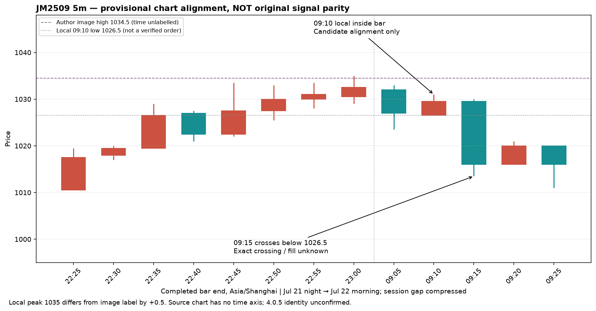

# 焦煤5分钟ibar：图解、双持、恢复与候选Bar对齐

更新：2026-10-17。**找到正文明确5分钟的焦煤信号图，并在本地行情找到相容的候选序列；仍不构成4.0.5原版信号验收。** 来源见[H01–H12索引](signal-chain-20261017.csv)，数值见[固定样本输出](jm2509-july22-geometry.json)。

## 1. 沿3月图解追踪

沿G09引用，搜索`2025.3.10`找到[H01常驻组合文章](https://weibo.com/ttarticle/p/show?id=2309405142719394873414)。JM2505图画出1094附近ibar及破位后的环境反转，但裁掉周期、时间轴与完整价格轴；所读章节未明确4.0.5，无法唯一定位作者Bar。

[日盘H02](https://weibo.com/1885745060/PhTZHhVtX)图列JM2505空10、今仓10、开均1082.40。正文称下午新开焦煤/焦炭，末尾却称下午新开“无”，保留矛盾。[夜盘H03](https://weibo.com/1885745060/PhX655JCl)仍列焦煤空均1082.40，数量列受水印影响，本次未独立复核；不能证明唯一开仓时刻或同账户连续持有。

H03菜油叙述再次说明，用于锁定的ibar不自动授予反向做空许可。正文称锁定，末尾列止盈，截图未列菜油，缺少中间动作，不能将两词强行解释成同一订单。H01玻璃BD绿叉消失K线保护线索也保持版本未知，不移入4.0.5算法。

## 2. 7月22日信号与持仓链

主页`BBB`检索找到[H06：7月22日09:25](https://weibo.com/1885745060/PCeX7pZ6t)。正文明确早上VPLUS在5分钟，BBB用于锁定。图2标注“V+信号的ibar破位”，箭头指向顶部回落中的反弹K，高点标签1034.5。**无时间轴、图内合约或周期标题。** JM2509由同帖图1持仓行支持，5m由正文支持，K线图具体合约是上下文推断。

|发布时刻，上海|直接可见内容|边界|
|---|---|---|
|7月22日09:25，H06|图1 JM2509多16、空16；图2信号；正文BBB锁定|图1表头裁掉，不单靠此图命名均价列；未明确4.0.5编号|
|7月22日09:32，[H11](https://weibo.com/1885745060/PCeZU3vrx)，已编辑|完整表头：JM多16、开均935.50、持均971.00、今仓0；空16、开均/持均1026.69、今仓16|标题为7月21夜盘，但正文明确次晨补发且已发生早晨锁定，不能归档为前夜快照|
|7月22日11:35，[H08](https://weibo.com/1885745060/PCfNTgbGb)，已编辑|正文称焦煤等开盘锁过，后基本全部解锁；图列JM多16、开均935.50、持均971.00、今仓0，未列空|未列空不等于已核实零空；同账户、平仓时刻及成交未知|
|7月22日15:08，[H09](https://weibo.com/1885745060/PChcgaEpm)，已编辑|承认锁定解锁频率增加及磨损|仅正文，未用收益自述验证账户|

合理推断是原多单先受到双持保护、随后恢复多向。合约、数量、均价及正文有连续性；不同账户、过滤、期间多次平开仍是替代解释。H08直接点名4.0.5的句子指多晶硅，不能借同帖把焦煤图升级为明确版本。因此焦煤身份仍是**LMS/BBB明确，4.0.5间接关联**。

## 3. 前日计划与盘后内容分开

[H12前日文章](https://weibo.com/ttarticle/p/show?id=2309405190910626627896)的JM2509章节给STEP1012–1016.5、涨停映射1048–1058；977–980.5风险前需经过991.5，选991.5之上的VPLUS保护；当次不考虑做空。主页入口显示7月21日18:16且已编辑，历史正文不变性未核实。

H06早盘将已完成的1012–1016.5用于回落观察，再看1025.5恢复或999风险。区域角色可能随路径推进改变，不能永久固定为原角色。

[H10盘后文章](https://weibo.com/ttarticle/p/show?id=2309405191273962405952)再次嵌入H06，不能计为独立信号；另给下一阶段1035（S崩溃/抵抗）、1022–1028.5（回调中断）、1002.5–1009.5（趋势破坏）。选择较早S风险附近找保护信号，并说极端波动下15m可能过迟、可能降5m。**盘后区域不能输入当天早盘重放。** 当前编辑后内容也不是历史事前可用性证明。

## 4. 本地逐Bar观察

既有`lms405_replay.read_local`通过MDS只读事务读取JM2509、交易日2025-07-21至07-22的5m，共138根。Bar结束时间覆盖7月18日21:05至7月22日15:00，包含交易日所属夜盘，不是自然时间连续覆盖。未自制聚合、下载、替换合约或修改生产数据；没有计算策略暖机。

输入目录：`output/lms405-jm2509-july22-20261017/market-read-authorized/`。
CSV SHA256：`71c668cc3874cfdcb1c52b47c26615a89ed455977bfb5c80883a9e18b3cb91b3`。
初次沙箱连接失败记录另存`market-read/coverage.json`，随后授权的本地只读读取成功。

以下为**本地Bar结束时间**。作者原图无对应时间及逐根OHLC，属于候选映射。

|时间|开|高|低|收|局部观察|
|---|---:|---:|---:|---:|---|
|09:05|1032|1033|1023.5|1027|回落阴线|
|09:10|1026.5|1031|1026.5|1029.5|高低点严格处于前根内；候选箭头对应|
|09:15|1029.5|1030|1013.5|1016|低和收均低于候选内包K低点1026.5|
|09:20|1016|1021|1016|1020|反弹|
|09:25|1020|1020|1011|1016|再跌；与帖子同一分钟，不假定发布前已完成|

涨跌顺序和相对形态与H06图相容。但本地前夜23:00顶部1035，作者图标签1034.5，候选对齐价差**+0.5**。可能涉及数据源、图表合约或对齐差异，原因未定位；不能因同属期货就认定数据完全相同。没有作者逐根OHLC，其他Bar误差不得填0。

候选解释是09:10形成内包结构，之后向下离开低点的过程中发生保护。1026.69为截图空腿平均价，不能反算准确下单/成交时刻，也不能排除更早或其他触发规则。OHLC没有09:10–09:15内部次序，无法确认盘中或收盘触发；普通内包几何不等于BBB完整公式。



复算命令（输出必须不存在；依赖上述本机冻结CSV，行情文件不随本次Git提交分发；其他checkout须先取得同哈希本地样本，不能自动下载或替换输入）：

```sh
python3 scripts/research/lms405_july22_geometry.py \
  --input output/lms405-jm2509-july22-20261017/market-read-authorized/JM2509_2025-07-21_2025-07-22_5m.csv \
  --output /tmp/lms405-july22-new.json
```

脚本绑定冻结输入哈希，只复算指定Bar包含/破低及高点差，不扫描调参，不输出策略信号、订单或收益。作者Bar时间为null，合格golden信号数0。09:25不满足严格早于页面分钟级发布时间；“Bar在发帖前”也不等于“该文章是事前输入”。

## 5. 对策略解释的约束

- [H07方法问答](https://weibo.com/1885745060/PCiB2Ct2F)：VPLUS是BBB高度精简版。先读环境、定位最小阻力水平区间、再由点位触发；常规波动/盘整较重形态，极端波动可能下移周期处理关键K。判据未知。
- [H04/E24复读](https://weibo.com/1885745060/Rjkl6CXtz)：明确4.0.5的M盘整模型，当次优先单循环试错、减少右侧追；不是所有状态永久单向。1–2%面向主观学习者，不是自用仓位证据。
- [H05 LC趋势案例](https://weibo.com/1885745060/ReQukpkxB)：明确4.0.5模型，弱侧破位前也可找反向信号保护，指定阻力区附近不加仓。附近范围及机械判据未知。
- H08：高频锁定需要盯盘、考虑止盈；次数和窗口未披露，不得补“锁两次就清仓”。

本批12条详情，其中H04复读E24，新增唯一来源11条，日期2025-03-10至2026-09-22。长文只读相关章节，逐条图片覆盖在索引中说明，不是全部图片全读。检索词：`2025.3.10`、`4.0.5 ibar`、`4.0.5 tbar`、`4.0.5 关键`、`BBB`、`2025.7.22`、`2025.7.21`。tbar组合暂无内容；ibar组合仅见混合版本股指摘要，未当焦煤证据。跳过股票/股指、备选品种重复入口和收益宣传；摘要数未完整计数，未达饱和。

通过登录Chrome正常访问，无购买、私信或绕过。图片记录原帖位置和文件名，未声称已归档原图。所有材料是开发证据，不是留出。当前新增可比较的5m局部候选与保护—恢复叙述，但**公式、唯一时间对齐、4.0.5身份、恢复触发及成交仍未闭环**。


补查既有[E09理论引用](https://weibo.com/ttarticle/p/show?id=2309405169074765693026)仍返回作者设置不可查看，错误码120002，未计新增已读详情，未绕过。

实际验证：冻结CSV复算与JSON一致；CLI重复计算一致；已有输出拒绝覆盖且内容未变；变更输入哈希拒绝；09:25不计严格早于；12行CSV完整性、本地引用、Ruff、定向secret及diff检查通过。独立Review重算138根与局部几何无差异，允许研究范围集成；未独立访问原网页/截图，保留该证据边界。策略核心未变，本轮未重复运行其既有58项测试，也没有运行收益回测。
