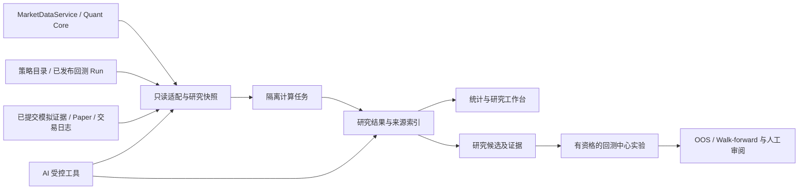

# 统计与 AI 研究中心设计

## 用户路径与分期

| 入口 | 用户能回答的问题 | 首次交付 |
| --- | --- | --- |
| 统计总览 | 某一来源、账户或 Run 的净收益、回撤和月度分布怎样？从异常月份回查原结算。 | V0.1 |
| 策略分析 | 固定规则后，哪个品种、周期、方向、日夜盘或市场状态的结果有差异？从单元格查样本和排除原因。 | V0.1 |
| 交易分析 | 计划执行率和提前退出情况怎样？从分布回到原案例、事前计划和成交。 | V0.1 |
| 因子实验室 | 趋势斜率、波动或持仓变化与后续价格有何关系？按因子、周期、窗口查看覆盖和分组结果。 | V0.1 先做单品种 |
| 市场与信号研究 | 突破确认后表现如何？比较相同起算条件下的基础事件和确认事件。 | V0.1 基础事件，V0.2 扩展 |
| AI 研究助手 | 带着问题选择已有研究工具，生成有证据、反例和局限的报告。 | V0.3 |

V0.1 先跑通一个具资格的物理合约 Run、一份已核验的日收益序列、一类单品种因子和一个突破事件。再扩到约 10–15 个有定义的候选特征，按数据可用性逐项开放。候选包括 EMA21/OLS 斜率、ATR 标准化斜率、N 周期动量、ATR 比率、量比、OBV 变化、OI 变化、突破距离、回踩深度和多周期一致性。已注册指标从 Quant Core 取值，研究派生表达式只在研究目录版本化。

V0.2 增加横截面、跨期稳定性、训练段参数搜索和更严格的统计检验，按需要接入模型。V0.3 接通有类型的研究工具。人工操作同一研究入口即可重算 AI 引用的结果。各期都可独立使用。

## 数据流与职责

| 所属领域 | 研究读取对象 | 读取边界 |
| --- | --- | --- |
| Market、Quant Core | MDS 的 completed BarSeries、交易日、Session、物理合约和 segment，以及同输入身份的已注册特征 | 从已校验的统一入口按修订读。跨周期做按可知时间向后匹配，换段重新预热。 |
| 策略、参考交易 | 策略目录的版本、profile、资格与限定，稳定 Marker / ReferenceTrade | 页面参考结果标明 page parity、不可执行。HTDY 仅用已留存的当时观察研究信号有效性。 |
| 回测 | 发布成功的指定 Run、原生权益、交易与成本、实验成员和资格 | 原生 Plus 输入与结算身份随结果保存。旧 TRIAL 仍按原身份显示。候选通过已有资格入口发起实验；不向 Plus 喂 MDS 行情。 |
| 模拟与 Paper | 已提交的柜台仿真快照、成交；已有 Paper 账本和估值投影 | 分来源、账户和交易日读取。缺少已对账的结算与现金流时只能研究已取得的成交。苏冰使用一个共享 Portfolio，品种仅作归因。 |
| 交易日志 | 有效案例关联、原计划版本、发生与录入时间、五维评价及复盘标签 | 人工评价作为事后信息。原生成交按来源、账户及原生 ID 去重。撤销或重新归案形成新样本修订。人工记录不能补全柜台或账户权益。 |

跨周期 actual dominant 按 MDS 的周期响应 owner 与 `MarketDataService.actual_dominant_segments` 返回的全局 rank1 段逐 Bar 核对。每根 Bar 必须唯一归属同一物理合约。短主力段没有完整周线时保留该段，依赖周线的特征在该段缺失。跨周期匹配只取严格早于决策时刻的可用特征。因果选约还须证明当时可知的映射；无法证明的主力任务拒绝，用户可另建有资格的物理合约任务。[行情查询合同](../../specs/market-series-query/spec.md)

日志中只有有效 `FILL` 关联可作为案例的执行证据，并须核对来源、账户、合约、方向、原生开平数量和费用。`COMPARISON` 用作研究对照，已撤销关联和 `replaces_manual` 指向的人工事件只用于追溯。案例建档本身不提供完整性证明，缺项时显示原始明细和缺口。

依赖实现可从 `services/quant-api/app/backtest_center`、`simulation_center`、`strategy_center` 进入。日志合同在 PR #691 已合入的提交可核对；落地前须在含该提交的基线上接线，运行时仍须验证来源可用及分页完整性。既有盘后研究的调度和发布由原模块负责。参见[回测合同](../../specs/backtest-center/spec.md)、[量化计算合同](../../specs/quant-compute-core/spec.md)、[模拟合同](../../specs/simulation-center/spec.md)及[日志合同](https://github.com/firehell/guiyi-quant-workstation/blob/62ed608042549cf0a5efe676147c4f316f9487d9/openspec/specs/trade-journal-center/spec.md)。

## 研究数据集与结果身份

一次任务固化问题、配置、截止时刻、来源引用和输入快照。快照按用途取列，保存数据集修订、来源类型及原 ID、账户或 run、策略/公式/profile、品种/合约/段/周期、交易日、发生与可用时间、窗口、质量和输入指纹。因子定义另带表达式版本、依赖特征、标签定义、分组与排除政策。特征和未来标签分列存取，预测输入字段采用白名单。

每份结果绑定 dataset ID/修订、任务 ID、代码和依赖锁、配置及指标定义、随机种子（适用时）、成员、样本量、排除计数和原因。账户、成本或数据修订不同的样本可并列查看；只有比较条件一致的组才可排序。多 Run 不拼接重叠权益，多个账户需先有获准的可对账组合估值才可形成组合曲线。样本薄弱、分母为零、数据不可用及已验证为空分别显示。

PostgreSQL 保存研究定义、任务状态、结果索引、来源关系。研究目录的 Parquet 保存重算所需派生样本、标签和结果，报告按结果 ID 只读查询。快照不可重取时用原留存样本及指纹复算，缺失则声明不可复算。原始全量行情留在上游。相同提交键只受理一次，显式重跑创建关联任务。任务先写私有临时目录并校验文件，再原子公布不可变文件，最后事务提交索引与成功状态。查询只认已提交索引；中断后按任务及校验和查明状态，迟到任务不能覆盖终态。

## 统计口径

- **日绩效。** 仅接受有明确币种、现金流处理、交易日历、估值边界与净成本定义的已核验日收益。保留原生值。调用库时显式设定年化期数、无风险利率单位和换算、复利与缺失政策、基准身份和共同覆盖；停市日按日历排除，缺结算的交易日显示缺口。资金流水或初始权益无法核验时禁算相应收益。V0.1 提供累计及年化复合收益、月度复合收益、最大回撤及持续交易日数、Sharpe、Sortino 和 Calmar。报告列明回撤持续期从前高至恢复或截至日，未恢复标记进行中。日胜率以有效交易日（含零收益日）为分母；风险指标样本不足或分母为零时标明原因。滚动风险与 VaR/CVaR 按需扩展。
- **交易统计。** 按来源声明的闭合交易或有效执行案例聚合原生数量、乘数、费用与实现盈亏，金额对账用 Decimal。部分平仓保留已实现分量和剩余仓位，完全平仓才进入逐笔胜率、盈亏比与 Profit Factor；闭合案例按最终平仓的交易所交易日计一次，保留开仓日；各日账户收益仍按原生结算日归属。逐笔胜率分母含平手，分子只含净盈利。仅有 Fill 且无可靠配对时可显示 Fill 数。无初始风险定义时禁算 R 倍数。绩效矩阵同时显示口径、资格、样本、成本及适用的置信区间。
- **交易路径。** 按原合约、方向和实际持有窗口计算 MFE / MAE。加减仓分段使用当时数量和成本基础；利润保留率要求分子分母同单位、同费用口径且 MFE 为正。仅有 Bar 时披露粒度，开平仓边界无法区分成交前后极值时排除边界 Bar 并标记覆盖；没有可用路径时返回缺项。极值仅用于事后路径描述。计划遵守率以事前有效且可判定的案例为分母，另列不可判定数。
- **模式。** 单品种时序分析在同一合约段关联可知特征与未来标签。横截面以同步决策时点和当时有效品种集合逐截面计算 RankIC、分位收益与覆盖；成员不足或秩无变异时不出相关值。事件研究预先声明去重、重叠及观察窗口（如 1/3/5/10/20 根）。三 Bar 确认以第三根已完成且可知的时点为锚，独立标出等待期间失去的样本。
- **验证。** 标签明确价格基准、期限和方向，例如同段确认后首根合法 Bar 起始至第 h 根完成的价格变动，仅作观察。执行收益来自有资格的回测结果。整段预热、尾部标签和跨换月样本显式处理。切分前登记训练/验证/测试、标签结束时间、参数搜索预算与选择规则；按标签可知时点清除跨界训练样本，变换只在训练集拟合。重叠窗口、自相关选用适用的分块或 HAC 方法，披露有效样本、参数和区间；多重比较记录检验族与校正。推断条件不足仅报描述统计。

## 计算复用与隔离

| 用途 | 选择 | 接入验收 |
| --- | --- | --- |
| 账户日收益与回撤 | QuantStats；RQRisk 仅按需对照 Plus 的已知口径 | 固定有亏损、零收益、现金流及缺日的样本，与独立手算和同定义原生指标比较；保留口径差异。 |
| 因子算子、分组与 IC | 独立评估 VeighNa Alpha 4.5.0，优先消费结构化结果，用 Polars 传入已计算特征 | 证明适用算子可接收本地快照和自定义标签；绕开日频默认未来收益、全样本过滤及 AlphaLab 存储。无法旁路的分析保持不可用。 |
| 分组、相关、回归与显著性 | Polars / NumPy / Pandas，SciPy / Statsmodels | 固定清洗和检验参数，分别检验单品种、同截面及重叠事件。 |
| 后续实验 | Optuna 限预算选参；按需要评估 arch、ML4T Diagnostic、LightGBM 或 scikit-learn | 复用回测中心实验身份与 OOS/WF；测试段隔离。 |

RQFactor 作为方法参考，RQPAttr 待明确组合归因需求。会员持仓、仓单等扩展字段待真实需求和授权核实。Alphalens/Pyfolio、Qlib/RD-Agent 和 TradeNote 只参考方法或交互，首期不另设统计、行情、回测或 ML 平台。上游参考见 [QuantStats](https://github.com/ranaroussi/quantstats)、[VeighNa Alpha](https://github.com/vnpy/vnpy/tree/4.5.0/vnpy/alpha) 和 [Statsmodels 协方差估计](https://www.statsmodels.org/stable/generated/statsmodels.stats.sandwich_covariance.cov_hac.html)。

FastAPI 接收有界研究请求、读取已发布结果，Vue 按来源、日期、策略等筛选并下钻原证据。耗时计算按任务启动本机隔离进程，限制并发、内存和运行时间，可取消；普通读请求不启动计算。独立锁定研究依赖，Apple Silicon / Python 3.13 先验证。Market 的 VeighNa 4.4.0 锁和 Quant Core 纯包边界继续由各自合同管理。以当前候选 57 品种记录输入清单、窗口、耗时、内存和并行前后业务延迟；资源预算应在实测前固定，超限则收紧并发或拒绝派工。

## AI 工具与候选回路

V0.3 向助手提供带类型的查询结果、运行已注册分析、引用证据、保存研究假设四类操作。输入验证快照身份、枚举、窗口与预算；返回结果 ID、覆盖、指标定义与错误。提交研究任务或写草稿只作用于研究域。工具不接受任意 Python、SQL、文件路径、账户操作或策略写入。模型只接收完成任务所需的最小研究摘要；向外部模型发送账户明细或日志原文需另行授权。报告区分计算结果、解释和待验证假设，保留引用与反例。

人工可把候选连同输入、版本及反证交给有资格的 Plus 实验；按既有合同查看 OOS、Walk-forward 与后续经批准的 Shadow 证据。每个阶段由所属中心记录。报告、得分或 AI 工具调用均无策略晋升或运行权限。
