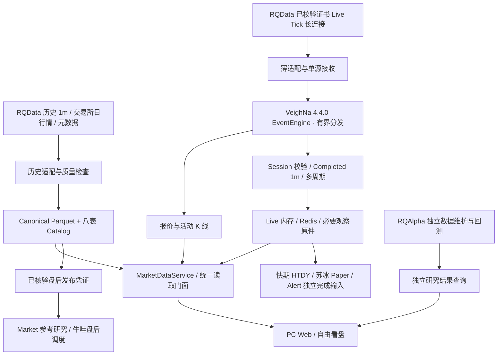

# Market Core 设计

目标机对照选择 Canonical Parquet + PostgreSQL Catalog。候选入口使用锁定的 VeighNa EventEngine
分发，保留归一 Decimal 行情对象、交易所 Session 和聚合。实际证据见
[存储与组件](evidence/storage/README.md)、[Tick 与完成流](evidence/tick/README.md) 及
[盘后与参考](evidence/archive-reference.md)。隔离装配与正式切换前置见 [切换准备](cutover.md)。

## 1. 目标结构

箭头为逻辑依赖，不要求每个框独立进程。Market 对外只暴露领域行情与必要事件；不输出 VeighNa 内部对象，不让消费者依赖数据库或供应商。现有 MDS 是历史读取权威，统一门面在现有查询/Live 组合层收敛，不强制把 Redis 与事件引擎塞进 MDS 类。RQAlpha 的数据路径不在本设计内，不要求其消费 Market 历史、Live、数据库或数据发布；既有 P3/P4 隔离路径若依赖 MDS，先保留原合同与入口，后续独立研究任务解除耦合。盘后参考触发与独立研究数据就绪不能互相冒充。

## 2. 第三方复用与自主职责

| 组件 | 目标与验证边界 |
|---|---|
| RQData | 现有历史 API、交易所日行情、日历/合约/rank1；LiveMarketDataClient Tick 权限、实际频率、连接及重连实测 |
| VeighNa 4.4.0 | 已锁定的社区版；独立环境验证，不顺带升级依赖。EventEngine、TickData、BarGenerator、BaseDatabase、DataRecorder 优先评估；DataManager 只复用适合无界面运行的功能，禁止为 Web 引入 GUI |
| vnpy_rqdata | 历史适配候选，不等于实时推送客户端。与现有原始响应对照字段、空值、时区、起止标签、精度、成交额/持仓量；不合格字段继续使用原 RQData adapter |
| 归一 Market | Calendar/Session、MainContractMap、物理身份、质量、完成性、盘后发布和恢复；只在原生组件不足时保留薄适配或已有实现 |
| PostgreSQL / Parquet | 历史存储择一；元数据仍为 PostgreSQL，Live 内存/Redis 按实际消费和恢复需要精简 |

不为复用而 Fork 上游、重写所有行情对象、维护常驻双方案，或额外引入另一套消息系统。现有源码与试验参考：[live_market](../../../services/quant-api/app/market_data/live_market.py)、[market_feed](../../../services/quant-api/app/market_data/market_feed.py)、[aggregation](../../../services/quant-api/app/market_data/aggregation.py)、[VeighNa 离线验证](../../../services/newow-vnpy/README.md)。VeighNa 已完成离线宿主验证不等于已接 RQData Tick 或达到本机行情性能。

## 3. 历史数据

一次完整历史建设与质量验收，随后每日增量更新。现有资产先审计并直接复用，不重新下载完整历史以迁移格式。保留现有低频只读历史审计合同，发现异常按范围修复，不每次全仓下载。维持 physical contract、主连与 actual_dominant 查询模式的区别；rank1 当时有效映射不从价格推测，指定合约和旧月未结义务不被主力覆盖。1m 与交易所 D1 为原始历史权威，分钟派生周期从 1m 按现行 Session 规则生成，W1 由完整交易周 D1 派生；七周期常用历史结果持久化。历史全 Tick 默认不下载和长期保存。

现有 Parquet + 八表 Catalog 仍是唯一正式历史权威。隔离比较 vnpy_postgresql 原生表/索引/批量读写与现有列式存储：同一真实冻结数据、同一标的/日期/周期、同一输出校验、同样冷/热缓存、同一目标 Mac mini M4 16GB。测试 500/5000/100000 根、代表性多品种历史扫描、日增量、资源占用及消费者并发；不测 RQAlpha 数据或引擎。候选 PostgreSQL 必须证明时间/交易日、Decimal 精度、空值与质量事实、完整覆盖、版本和原子可见性、重启恢复、现有消费者等价；原生浮点/Upsert 不自动视为满足。若需大量定制才达标或维护收益不明显，则保留 Parquet。两者正确性均满足且实际性能足够时，优先维护简单的一方，不以最高跑分选型。记录代码与运行组件可删数量和实际维护步骤；无足够证据则保留现有正式存储。最终只有一个 Market 历史权威，不长期双写；旧不可变证据不是第二活跃库。

## 4. 盘中 Tick 与收线

现有 RQDataLiveProvider 只接完整 1m；Tick 属候选升级，不是修改订阅配置即可完成，须验证接入、聚合及完成事件的全链路。先选择单物理合约，在隔离命名空间同时接 RQData Tick 与实时 1m 作对照，后者仅对照/必要恢复诊断，不能同时推进正式完成流；盘后再对比权威历史。真实权限、订阅限额、Tick 是否快照/缺序及字段语义以真实接收确认，不假定交易所完整逐笔。使用有界接收、批处理与可观测背压，页面只消费最新报价/活动 Bar，可合并展示刷新，不吞正式输入或决策事件。不把高频 Tick 全部写现有按分钟设计的 Redis ObservationStream（其既有容量和 TTL 有界）；必要原件保留策略与恢复证据按用途确定。

优先验证 VeighNa 原生 Tick→1m 与高周期聚合。适配 Tick 累计量、额差分、首次基线、夜盘跨日、交易日累计重置和断线缺口；短休/午休不能盲目重置仍连续的累计值。归一 Session 为边界权威，若原生高周期不匹配，复用现有 Session-aware aggregator，而非重新发明。明确事件时刻与接收时刻、统一 bar_end；活动 Bar 不进入正式策略。现有确认宽限作为对照基线（2 秒与 session 尾部规则按现行合同），实测后确定；无下一 Tick 的末根可在来源足以确认时 flush，不能由时钟制造价格或补造空分钟。来源迟到、重复、异值或断线分别记录；恢复来源不得伪装成当时观察或重放开仓。对确已完成且已消费的输入不静默覆盖。一个正式输入流仅一个 writer/源代次，切换需末水位、停旧、新源预热及读回。

## 5. 盘后与统一读取

| 阶段 | 查询行为 |
|---|---|
| 交易中 | 已归档历史 + 当日已完成 Live + 展示用活动 Bar；同物理身份去重 |
| 短休/午休 | 保持当日 Live，不日终清理；合法 Session 尾段仍按既有规则完成 |
| 日盘收盘、历史未就绪 | 保留最后有效 Live，标明待归档/失败及真实截至时间 |
| 归档成功 | 已归档范围只读新历史版本；下一交易日 Live 按交易日独立覆盖 |

沿用既有 18:05 维护入口与授权范围，时钟不是供应商就绪证明。RQData 再取完整交易日 1m 和交易所 D1，验证端点、身份、质量、修订并重建受影响周期；周线只在完整周发布。正常数值修订不阻断合格历史发布，不改写盘中决策和账户。新版本先校验/真实读回后原子可见；失败旧成功版本保留，提交未知先独立读回，不盲重试。正式发布凭证仅在应完成范围读回成功后发出，复用既有成功事实、去重及补领；Market 参考研究盘后才消费。若下一交易日已开始，只清理本次已归档的旧日可再生缓存，保留原件、游标和未结义务。目标 RQAlpha 数据由独立研究域维护；本阶段不新增或修改其数据更新及触发器，既有 P3/P4 试验保留原身份。

## 6. 性能与部署

目标机为既有 Mac mini M4 / 16GB；正式 universe 不扩，58 品种正式负载、70 仅隔离容量；同时统计实际物理订阅数、换月重叠。初始建议门槛：500 根热查询 p95≤100ms，5000 根 p95≤300ms（服务端含读取/转换，不含浏览器网络）；本地 Tick 从收到到报价/聚合处理 p95≤100ms（不含供应商传输）。记录冷/热查询、p99、峰值、积压年龄、RSS/CPU/swap、磁盘与重启恢复。正常 completed 输出在确认宽限后及时完成，无持续积压、无漏重；自然行情及真实 Tick 的差异按源/时段归因，未证明不宣称达标。盘后正常批次应在下一交易时段前完成；超时显式待更新，独立模拟必须继续且无新增风险。代表性测试包含完整交易日（日夜盘、短休、午休、末根、换月、断线重连、迟到和重复），以及行情/后台 Market 作业并发。目标调整需说明基线及使用影响，不降正确性断言换性能。RQAlpha 的数据、回测性能和维护不属于本阶段指标。

## 7. 切换及退役

先隔离测量后选型；保持现有生产配置不变。先清点读写者及原件引用，证明新旧数据逐值和语义、现有账户输入、历史/实时切换正确；如聚合口径需要改变，明确策略时序影响及另行决策，禁止静默改变。对受影响 active requirements 提交精确 delta，不提前改 accepted 规则或宣布完成。正式历史写入/迁移、主源切换及 Runtime 另行授权；切换前保护旧事实、可核验恢复和消费水位，未知状态停止有关 mutation。查清所有旧消费者（包括现有隔离 RQAlpha 路径的遗留 MDS 读取）后方可退役相应实现；只保留确有用途的兼容读取，最终不养两套 active 实现。历史研究原件、订单/成交、通知、旧恢复引用禁止因市场迁移删除。
