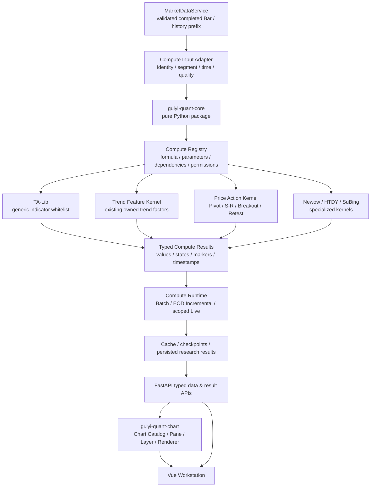

# Quant Compute Core 与 Quant Chart 设计

## 1. 设计原则

1. **计算与显示分离。** Quant Core 输出指标数值、特征、状态和标记；Quant Chart 只负责把有明确来源的结果渲染成图层。
2. **少而精。** 通用指标采用固定白名单，策略专属公式按原身份保留；不以指标数量衡量能力。
3. **一个公式一个权威。** 通用指标由 TA-Lib 提供；自研趋势/形态与 Newow、HTDY、SuBing 专属内核由 Quant Core 管理。不得在多个策略或前端复制同一通用公式。
4. **按需计算。** 显示开关、颜色和 Pane 布局不触发计算；只有显式消费者依赖的指标才进入计算依赖图。
5. **因果与回看分离。** 发生时间、确认时间和可用时间独立表达；回画只属于展示，不授予历史信号或交易资格。
6. **独立发布。** Quant Core、Quant Chart 各自版本化；包版本、公式版本、状态 schema 和结果 schema 分开。
7. **渐进迁移。** 复用现有计算与 Primitive，先接入 Registry/Adapter，再逐步迁移页面；不为目录整洁重写成熟公式。

## 2. 总体架构

Quant Core 不导入 RQData、VeighNa、FastAPI、Vue、PostgreSQL 或 Redis。Compute Runtime 位于应用服务侧，负责取数、调度、缓存、检查点和结果发布；它不是纯计算包的一部分。Chart 包不直接连接 MarketDataService 或数据库，通过应用层取得的 typed data/result 渲染。

## 3. Quant Core：独立纯计算包

### 3.1 输入与输出合同

输入为经过 Market Core 校验的不可变 BarSeries/数组视图，至少携带：

- product、physical_contract、segment_id；
- frequency、trading_day、session_id；
- bar_end、available_at/confirmed_at；
- source_revision、quality_status；
- OHLCV；OI 可作为原始行情字段存在，但不进入本次通用指标白名单。

TA-Lib 输入转换为连续 float64 NumPy 数组。Decimal 价格事实、账户资金、委托/成交价格仍由各自领域保留；TA-Lib 浮点输出是分析结果，不得冒充交易账本价格。

统一结果至少包含：

- feature_id、formula_version、parameters_hash；
- product、physical_contract、segment_id、frequency；
- bar_end、available_at；
- status（READY/WARMING/UNKNOWN/INVALID/ERROR）；
- values、markers、diagnostics；
- result_schema_version、source_revision。

缺少数据、预热不足、输入质量失败不得用 0 或上一值伪装成正常结果。

### 3.2 通用指标白名单

通用指标唯一计算后端为 TA-Lib；不保留并行的自研 EMA/MACD/ATR 通用实现，也不要求建立旧实现与 TA-Lib 的逐值 parity gate。只验证输入有效性、预热、输出有限性、参数和计算运行正确性。

| 类别 | 对外指标 | 默认参数 | TA-Lib/实现 |
|---|---|---|---|
| 趋势 | EMA10 / EMA21 / EMA60 | period=10/21/60 | `talib.EMA` |
| 动量 | MACD | fast=12, slow=26, signal=9 | `talib.MACD` |
| 波动 | ATR | period=14 | `talib.ATR` |
| 波动 | STDDEV | period=20, nbdev=1 | `talib.STDDEV` |
| 通道 | BOLL | period=20, upper/lower=2, matype=0 | `talib.BBANDS` |
| 价格区间 | HHV / LLV | period 必填或由消费者配置 | `talib.MAX(high)` / `talib.MIN(low)` |
| 成交量 | OBV | TA-Lib 默认定义 | `talib.OBV` |
| 成交量 | Volume Ratio | 默认 N=5 | NumPy 简单滚动计算 |

约束：

- 不提供 SMA/WMA 独立指标，不提供 RSI/KDJ/CCI/ADX 等其他通用指标，不提供 OI 衍生指标。
- BOLL 内部中轨算法不因此注册成独立 SMA 指标。
- HHV/LLV 的通用序列窗口包含当前输入 Bar；突破算法需要“前 N 根参考区间”时显式 shift 当前 Bar，不能复用含当前 Bar 的结果冒充前序阈值。
- Volume Ratio 默认定义为当前已完成 Bar 的 volume 除以前 N 根已完成 Bar 的平均 volume，分母不包含当前 Bar；零分母返回 UNKNOWN/INVALID，不猜测为 1。
- TA-Lib 的 NaN/预热输出必须转为明确的 READY/WARMING 状态；不得把 NaN 填 0 后继续传播。
- 指标数值不在计算内核中做展示性小数舍入；精度格式由 Chart Renderer 决定。
- 通用 EMA 仅暴露 10/21/60。Newow/HTDY/SuBing 内部专属公式即使使用其他周期的 EMA/SMA/WMA，也保留在自己的公式版本中，不受通用白名单删除影响。

### 3.3 趋势特征

趋势特征库只整理已有自主能力，不新增一批未经验证的因子。首版保留：

- 趋势方向；
- EMA21 斜率；
- OLS 斜率；
- ATR 归一化斜率；
- 当前已存在的趋势状态判断。

现有 `indicators/subing_trend.py` 是迁移起点。ABU 的趋势角度、价格位置等仅作为未来研究参考，不进入首版正式注册，不复制 GPL 源码。趋势特征读取通用 EMA/ATR 等结果，不重复计算基础指标。

### 3.4 公共形态识别

公共 Price Action Kernel 首版仅包含：

1. Swing Pivot：Swing High/Low、HH/HL/LH/LL；
2. Support/Resistance：由确认 Pivot 聚合成支撑/阻力区域；
3. Breakout/Breakdown：基于前序 HHV/LLV、ATR 缓冲及可选成交量条件；
4. Retest/Pullback：突破后回踩、测试、确认或失效的有限状态机。

形态结果必须区分：

- occurred_at/pivot_at：形态发生时间；
- confirmed_at：满足确认条件的时间；
- available_at：系统实际可以使用该结果的时间。

右侧 K 线确认、回看标记或历史窗口扩展不得回填成当时可用信号。回看展示必须显式标注 retrospective/repainting，且不得获得策略、回测、Alert 或 Live 权限。

ABU 的多维特征组织和 TradingView Pivot + ATR 过滤思路可以作为算法参考；不引入 ABU 全套系统、多项式/BFGS/KMeans 重型全历史拟合或大型形态库。

### 3.5 策略专属内核保留

Newow 的趋势带、escape D1/D2/D3、杯柄、震荡通道/状态机、突破与影线展示、主力控盘、涨跌动能、照妖镜、趋势转折等继续保留原公式版本和状态机。

HTDY 原始/严格公式、SuBing 预警和研究公式继续遵守各自 canonical。TA-Lib 通用指标替换不得顺带改写它们的内部 EMA、SMA、WMA、MACD、ATR 或量能条件。

现有 Newow 副图：

- `main_force_control`；
- `up_down_energy`；
- `zhaoyao_mirror`；
- `trend_reversal`。

照妖镜必须继续 `repainting=true`、`formal_signal_eligible=false`，只供回看展示。主力控盘等名称不证明真实席位/持仓；副图输出不是账户或策略动作。

## 4. 计算运行与性能边界

计算运行由应用侧 Compute Runtime 统一管理三种模式：

| 模式 | 用途 | 允许消费者 |
|---|---|---|
| Batch | 历史图表、初次历史计算、回测预热 | 显式历史查询/研究任务 |
| Incremental | Canonical 盘后发布后更新受影响结果 | Newow 盘后参考及获准研究消费者 |
| Live | 已完成 Bar 的有限增量计算 | 明确需要的快期 HTDY、苏冰独立模拟消费者 |

Newow 参考策略只由盘后发布触发，不订阅 Tick/盘中计算。Live 不在每个 Tick 上运行全部指标；只为订阅者、品种和周期计算必需依赖。活动 Bar 只作展示 preview，不进入正式 completed 计算。

性能规则：

- 使用 NumPy 连续数组 + TA-Lib C 实现标准指标；简单滚动运算使用 NumPy/有界算法；复杂形态使用有界状态机。
- 建立按 `input_revision + owner + segment + frequency + feature_id + formula_version + parameters_hash + as_of` 组成的计算身份，避免跨合约、跨修订或跨公式复用缓存。
- 同一依赖节点在相同输入身份下只计算一次；多个策略共享结果，但账户/交易状态不共享。
- Batch/重型计算使用有界后台任务，不阻塞 API、行情 EventEngine 或独立模拟消费者。
- 增量状态检查点必须包含 state_schema_version；状态不兼容时从验证过的历史前缀重建，不强行恢复。
- TA-Lib Streaming 句柄是进程内实现细节，不直接作为持久化检查点合同。
- 性能验收在现有 Mac mini M4/16GB 环境，以 57 品种 × 7 周期的实际依赖矩阵测 P50/P95/P99、CPU、RSS、任务积压和缓存命中；先记录基线再设数值门槛，不以牺牲正确性换速度。
- Web 请求只读已发布结果/缓存；未命中时提交有界任务，不同步执行全历史复杂计算。

## 5. Quant Chart：独立图表包

新增 `@guiyi/quant-chart`，复用现有 Lightweight Charts，不替换底层图表库。它管理图表资源和渲染，不管理策略公式、行情来源或账户事实。

### 5.1 计算注册与显示注册分离

**Quant Core Compute Registry** 是计算语义权威，管理：

- feature_id、category、formula_version；
- input_fields、dependencies、parameters；
- supported_frequencies、lookback/warmup；
- batch/incremental/live capability；
- causal/repainting；
- web/backtest/live/alert 等使用权限；
- output_schema_version。

**Quant Chart Display Catalog** 是显示权威，管理：

- indicator_id；
- source_type（quant_feature / business_fact / display_transform）；
- pane（main / volume / auxiliary）；
- renderer_id；
- style defaults、display config schema；
- default_visible、profile allowlist、sort order；
- display_version。

两个注册表用稳定 ID 关联。Chart Catalog 不复制计算公式、指标参数和策略规则。CI/契约测试必须检查所有 `quant_feature` 显示项均能解析到 Compute Registry，输出 schema 与 Renderer 匹配；业务事实必须声明来源 owner；纯显示变换不得伪装成 Quant Core 策略特征。

首版使用静态类型化注册表，不做运行时任意 Python 插件上传或动态执行代码。

### 5.2 图表布局

逻辑布局分为：

- **Main Price Pane**：K 线、EMA/BOLL/趋势带/通道/形态/价格水平等主图图层。
- **Volume Track**：沿用同一主图的成交量 series/价格时间轴，不因每个成交量显示规则创建重复行情序列。
- **Auxiliary Pane**：MACD、ATR、STDDEV、OBV、Newow 自定义副图等独立数值面板。

主图、成交量和副图共享时间坐标、viewport、crosshair 与 Bar identity；不同副图有独立价格轴。Chart Engine 支持有界多个副图，初始产品布局最多 3 个；现有 Newow Profile 默认仍为一个被选中的副图，切换组件替换该 Pane，不默认同时展开四个 Newow 副图。Free/HTDY/SuBing 保留各自当前默认行为。

### 5.3 Renderer Registry

首版通用 Renderer：

| Renderer | 用途 |
|---|---|
| Line | EMA、MACD 线、ATR、OBV、趋势线 |
| Histogram | MACD 柱体、量能、主力控盘等柱体 |
| Band | BOLL、趋势带、震荡通道 |
| Marker | Pivot、突破、九转、D1–D6 等标记 |
| PriceLevel/Zone | 支撑阻力、目标价、吸筹价 |
| Primitive | 杯柄、复杂自定义几何、背景区域等特殊绘制 |

优先组合通用 Renderer；只有通用能力无法表达时才新增专用 Primitive。每个 Layer 必须拥有自己创建的 Series/Primitive/listener，提供 mount/update/detach/dispose；不得销毁其他 Layer 或整个共享图表。

### 5.4 现有自定义指标与成交量显示迁移清单

| 现有能力 | 目标归属 | 约束 |
|---|---|---|
| EMA10/21/60、MACD、ATR、STDDEV、BOLL、HHV/LLV、OBV、量比 | Quant Core + 通用 Renderer | TA-Lib/NumPy 计算，显示参数不改变公式 |
| Newow trend_band、trend_channel、oscillation_channel、Donchian、动态箱体 | Newow Compute + Main Renderer | 保留公式与参数身份及各自能力范围 |
| Newow main_rise、cup_handle、breakout_shapes、wicks、D1–D6、high/low、nine-turn、主力攻击线、目标价/吸筹价、双策略背景 | Newow Pattern/Display + Marker/PriceLevel/Zone/Band/Primitive | 保留结构、动作、Hint、detail、stop、Donchian、trend/oscillation track 与 comparison background 的独立开关；发生/确认/可用时间分离 |
| Newow main_force_control、up_down_energy、zhaoyao_mirror、trend_reversal | Newow Compute + Auxiliary Renderer | 保留四项既有副图；照妖镜回看-only |
| HTDY 原始观察图层 | HTDY 专属计算 + Main Renderer | 保留重绘/观察权限，不进入严格策略信号 |
| Lux Range | 现有 Range Detector Kernel + Band/Zone Renderer | 继续遵守 active range-detector canonical，只读展示 |
| 建仓/清仓、Hint、Alert、模拟委托/成交 | 对应业务事实 + Marker/Layer | 不注册成通用技术指标，不由图表重算 |
| `guiyi_volume_display_v1` 特殊着色 | Quant Chart display_transform | 保留现有成交量/实体/穿透评分和颜色；仅显示 |
| `subing_volume_tier_display_v1` | Quant Chart display_transform | 保留同物理合约、同计算段、前一根 completed volume 的 2x/3x 档位；仅显示 |
| Newow 特殊成交量/实验量能映射 | Newow Chart Profile/adapter | 保留现有逻辑，不被通用成交量规则覆盖 |

现有显示规则按原身份保留，不把不同策略合并成一个“量比”：

- `guiyi_volume_display_v1`：仅在同物理合约、同 segment、同 calculation segment 且输入 confirmed 时计算；沿用现有 10 根窗口（包含当前 Bar）。volume ratio ≥1.5 得 2 分、≥1 得 1 分；body ratio >0.6 得 2 分、>0.3 得 1 分；penetration ratio >0.03 得 2 分、>0.01 得 1 分。上沿/下沿任一方向总分达到 4 才使用特殊黄色，其余仍按涨跌红绿显示。
- `subing_volume_tier_display_v1`：当前 Bar 与前一根 completed Bar 比较，要求物理合约、segment 和 calculation segment 相同且中间无 Session interruption；2x 至不足 3x 标记 Tier 2，达到 3x 标记 Tier 3。保留现有 Free/HTDY/SuBing 使用范围，Newow 不套用该规则。
- Newow volume/experiment adapter：继续按原有 source identity、OHLC 和 calculation segment 对齐，不把实验结果或缺失量能伪装成有效 volume。

成交量规则只改变颜色或标记，不改变 OHLCV 原始值、策略输入、订单或信号。若未来量能公式被策略复用，需另建 Quant Core feature_id 和独立公式合同，不能直接把显示评分提升为策略特征。

### 5.5 Chart Profile 与用户配置

Chart Profile 为 Free、Newow Trend/Oscillation/MainRise/Dual、HTDY、SuBing、Backtest 等产品视图提供默认图层组合。Profile 只定义默认选择、Pane 和样式，不改变计算公式或策略能力。

用户偏好沿用现有本地浏览器偏好存储并增加 schema version，按 profile 保存可见指标、参数、颜色、Pane 顺序和高度。迁移需保留现有 Newow/详情偏好，不新建多用户配置数据库。

Newow 继续保留一个默认选中副图；用户可从 Catalog 增加其他副图到新 Pane。其他产品的默认配置保持现状，不能因为统一 Chart Engine 自动增加副图或改变成交量样式。

### 5.6 指标生命周期

| 操作 | 语义 |
|---|---|
| Add | 将 Catalog 项加入当前 Profile/Chart，并按需请求计算 |
| Hide | 暂时隐藏图层；不删除定义，不影响其他消费者 |
| Remove | 从当前图表配置移除并释放本图 Layer 资源；不删除算法 |
| Configure | 参数变化使对应计算 key 失效；颜色/线型/Pane 变化只更新显示 |
| Retire | 禁止新 Profile 选择，保留历史结果和旧配置的明确状态 |
| Delete implementation | 只有全仓消费者、Profile、策略、回测和 Runtime 引用均清零后才允许删除源码 |

删除图层不等于删除计算能力。若某个隐藏指标仍是策略依赖，Compute Runtime 仍须计算；若某个图层不再显示且没有其他消费者，才可以停止该图层专属的计算请求。

### 5.7 显示诊断

每个图层诊断至少包含 indicator_id、package/formula version、source identity、frequency、Pane、renderer_id、status、warm-up、数据截止、cache state、计算/渲染错误和最后更新时间。诊断用于区分数据缺失、计算未就绪、Catalog 不匹配、Renderer 不支持和资源释放问题，不得用空白图层掩盖错误。

## 6. 独立包版本与发布

Monorepo 保留，独立发布单元为：

| 包 | 产物 | 消费者 |
|---|---|---|
| `guiyi-quant-core` | Python wheel + sdist | Quant API/Compute Runtime/研究工具 |
| `@guiyi/quant-chart` | 独立 TypeScript 包/tarball | quant-web |

- 开发环境可以使用本地 path/workspace 依赖；正式构建必须锁定精确包版本和 artifact hash，不得依赖 editable path 或 latest。
- Quant Core 使用独立 SemVer；Quant Chart 使用独立 SemVer。两者发布不自动升级 API/Web。
- API 的 `APP_VERSION` 仍是应用版本；Web 应用版本继续按当前构建规则。升级某个包时，消费者显式更新依赖锁并重新构建/重启受影响应用。
- 包版本与 formula_version、state_schema_version、result_schema_version、chart_catalog_schema_version、renderer_version 分开。
- 包 manifest 暴露 package name/version、API/schema contract 和依赖版本。消费者启动或构建时检查兼容性；不兼容时 fail-closed，不静默回退到旧公式。
- Quant Core Release 构建 wheel/sdist，在干净 Python 3.13 环境安装产物并运行包内测试；Quant Chart Release 构建 tarball，在干净 Web 测试环境安装并运行类型、单测和渲染测试。
- 先以 Monorepo + 独立 package version + Release artifact 落地，不要求公开 PyPI/npm、不拆 Git 仓库、不创建微服务。
- Package Release 与 API/Web 部署、正式 Runtime 升级是不同动作；发布包本身不热替换正在运行的消费者。

## 7. 迁移与验收原则

- 先整理计算/显示 Registry 和合同，再逐项迁移现有组件；不一次性重写 KlineChart 或 Newow Workspace。
- TA-Lib 基础指标只按白名单实现；不设置旧通用公式逐值 parity gate。验证 TA-Lib 安装、参数、输入有效性、预热、NaN 状态、输出有限性、批量/增量调用和实际性能。
- Newow/HTDY/SuBing 现有专属公式和 golden 不得因通用指标迁移而更新；若确需改动，必须作为独立公式变更。
- 视觉回归覆盖 Newow Trend/Oscillation/MainRise/Dual 主图图层、四类 Newow 副图、通用 MACD、HTDY/SuBing/Free 默认配置、三类成交量显示、策略 Marker 和 Pane 对齐。
- 计算测试与图表测试分开：前者验证数值/状态/因果性，后者验证 Renderer/布局/颜色/时间轴/资源生命周期。
- 在 57 品种 × 7 周期的实际消费者矩阵上测量，不预先承诺未经测量的毫秒门槛；后台历史计算不得影响行情和独立模拟。

## 8. 明确不采用的方案

- 不将 Quant Core 迁移到 VeighNa CTA/PortfolioStrategy；VeighNa 只作为市场/事件等基础设施，Quant Core 保持纯计算。
- 不把全部计算交给 ArrayManager；TA-Lib 是通用指标唯一实现，复杂策略公式仍在 Quant Core 专属模块。
- 不引入 ABU 全套系统、GPL 代码复制、大型形态库或机器学习识别。
- 不让 Web 请求执行全历史计算，不在每个 Tick 计算所有指标。
- 不把所有副图默认同时显示，不为每个指标创建新的 KlineChart 实例。
